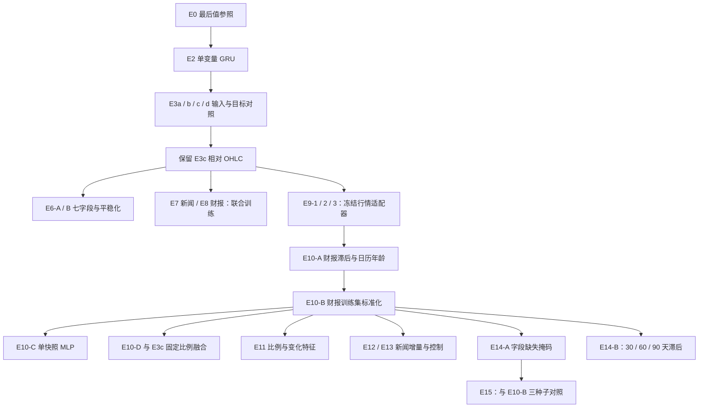

# GRU 系列实验对照与结论

面向组会或阶段汇报，请阅读 [实验路径与结果汇报](gru_report.md)；本文保留更完整的技术对照与原始结果索引。

记录日期：2026-11-02。本文依据仓库现有实现和结果文件整理，没有重新训练；指标展示到小数点后六位，实验名链接指向原始 JSON。完整逐轮曲线以各实验的 `history` 为准。

## 1. 当前应该保留什么

**目前保留 E3c 作为行情骨干，E10-B 作为行情＋财报主线候选，E10-D 作为固定比例融合候选。** E14-A 的缺失掩码和 E14-B 的更长财报滞后没有形成稳定改进；现有新闻方案也未取得开发集上可靠的内容增益。

这里的“主线候选”不代表每个指标都最低：E3d 的开发 MAE 低于 E3c，E3c 的开发 MAE 略低于 E10-B 的 seed 42，E10-D 的开发 MAE 又低于这几组；E13 真实新闻的单次 Holdout 优于原 E10-B，但开发 MAE 比基座和两个新闻控制组都差。模型选择必须同时交代比较范围和证据，不能只取一个有利分数。

本文覆盖 E0 参照、E2～E3、E6～E15 中沿用 GRU 骨干的尝试。E1 DLinear 是独立路线，详见 [E1 结果](../experiments/e1_dlinear/RESULTS.md)，不包含在“GRU 系列最优”的判断里。原路线中的 E4/E5 和 SpecTF 不在本文的已完成结果范围。

阅读入口：[项目数据与任务](intro.md) · [实验目录索引](../experiments/README.md) · [最初实验路线](experiment_route.md)。实际 E10 编号已经用于财报实验，不是原路线中计划的 SpecTF。

## 2. 所有结果的共同尺度

### 2.1 数据、目标与输入形状

| 项目 | 当前设置 |
| --- | --- |
| 股票数量 | 810 只 |
| 训练集 | 587,587 个窗口，仅此部分训练参数 |
| 官方验证集 | 76,950 个窗口，再切为开发、边界排除、Holdout |
| 输入长度／预测长度 | 96 个交易日／未来 24 个交易日 |
| 原始行情 | `[B, 96, 7]`，OHLC、成交量、分红、拆股 |
| E2 输入 | `[B, 96, 1]`，标准化 Close |
| E3c 行情输入 | `[B, 96, 4]`，相对 OHLC |
| 新闻原始向量 | 每天 `[篇数, 512]`，篇数不定 |
| E9-1/E12 新闻语义输入 | 每天 mean＋max，`[B, 96, 1024]`，另有存在与数量信息 |
| E10-B 财报输入 | `[B, 96, 16]`，同一份最新快照复制 96 次 |
| E10-C 财报输入 | `[B, 16]`，单次快照 |
| 预测与标签 | `[B, 24]`，股票训练期统计量标准化的 Close |

对股票 s，标签和最后值参照分别是：

```text
y[s, h] = (future_close[s, h] - close_mean[s]) / close_std[s]
last_z  = (input_last_close - close_mean[s]) / close_std[s]
```

`close_mean`、`close_std` 是该股票训练期固定统计量，同一股票各窗口共用，**不是每个 96 日窗口临时计算的均值和标准差**。E3c 的输入另做 `OHLC / input_last_close - 1`，这不改变标签尺度。

### 2.2 时间切分

以 [validation_split.json](../experiments/validation_split.json) 为准；20% 指官方验证集最后 20% 的**不同预测起始日期**，不是随机抽取 20% 样本。

| 部分 | 样本数 | 预测起始日范围 | 用途 |
| --- | ---: | --- | --- |
| 开发验证 | 42,930 | 2023-10-09～2023-12-20 | 早停、挑选检查点与超参数 |
| 边界排除 | 18,630 | 2023-12-21～2024-01-23 | 其未来 24 日标签会覆盖 Holdout 时期，不参与评价 |
| 本地 Holdout | 15,390 | 2024-01-24～2024-02-27 | 训练结束后报告 |

开发标签最晚到 2024-01-23，早于 Holdout 第一个预测日。两个部分的历史输入可以重叠，排除规则主要隔离**未来标签日期**，不是要求历史输入也完全隔离。Holdout 起始日范围也不代表其全部未来标签的日期范围。

Holdout 没有参与训练循环中的早停，但已经被反复查看并影响后续研究方向，不能再视为完全未使用的最终测试集。官方隐藏测试集仍不可见。

### 2.3 损失、评分与检查点

```text
error = prediction - y
MAE   = mean(abs(error))
MSE   = mean(error ** 2)
loss  = MAE + 0.2 * MSE
```

MAE、MSE 对全部样本及 24 个预测位置等权平均，均在上述标准化价格尺度上计算，越低越好。损失的 0.2 是训练目标中的系数，不表示 MSE 恒占总损失的 20%；本文不推定官方隐藏评分采用同一加权公式。

E3 及后续主要 GRU 实验默认 AdamW、学习率 `3e-4`、batch size 256、weight decay `1e-5`、最多 20 轮、patience 6、梯度裁剪 1.0；历史实际设置以结果及对应代码为准。开发 MAE 决定最佳训练后检查点，训练结束重新加载该检查点再评价 Holdout。

零初始化预测头或门控使 epoch 0 等于 E0、E3c 或 E10-B 对照。主要对照记录选择 epoch ≥ 1 的权重，便于观察训练是否有用；**最佳训练后权重也可能比初始化更差**。不能因为训练了，就默认优于对照。

两个例外需单独比较：E3d 在相对收益尺度训练，换回标准化 Close 才算评价指标；E13 用 Ridge 的平方误差＋L2 正则直接求解，不使用上述 GRU 损失或早停。因此不同实验的 `train_loss` 不一定可直接横比。

## 3. 演进关系



箭头表示实验来源，不表示每一步效果都有提升。E9-1、E9-2 分别使用新闻、财报，E9-3 使用两者；E9-3 默认从两个单模态适配器的检查点初始化，联合训练适配器，行情始终冻结。

## 4. 纯行情：先解决输入表示

### 4.1 E0：最后值是必须保留的参照

| E0 无训练基线 | 开发 MAE | 开发 MSE | Holdout MAE | Holdout MSE |
| --- | ---: | ---: | ---: | ---: |
| 最后值复制 | 0.217307 | 0.131206 | 0.354286 | 0.330340 |
| 过去 5 日均值 | 0.230412 | 0.142225 | 0.378627 | 0.358666 |
| 过去 10 日均值 | 0.246450 | 0.155649 | 0.392914 | 0.381531 |
| 过去 20 日均值 | 0.275334 | 0.180933 | 0.406871 | 0.414519 |

来源：[E0 原始结果](../experiments/gru_e0/e0_val_results.json)。移动平均仅用输入末尾 k 天收盘价，计算一次均值后复制到未来 24 天，不会引入预测期的真实价格。最后值在这四种无训练策略中最好。

### 4.2 E2、E3 与 E6

这些模型都使用单层单向 GRU，默认隐藏维度 64，最后隐藏状态通过线性头直接预测 24 步；大部分方案输出 `last_z + residual`。

| 实验／原始结果 | 主要变化 | 最佳轮次 | 开发 MAE | 开发 MSE | Holdout MAE | Holdout MSE |
| --- | --- | ---: | ---: | ---: | ---: | ---: |
| [E2 初版](../experiments/gru_e2/results.json) | 单变量标准化 Close | 1 | 0.241438 | 0.167650 | 0.398728 | 0.438897 |
| [E2 第二次记录](../experiments/gru_e2/results_v2.json) | 单变量 Close，另一次历史运行 | 1 | 0.243777 | 0.164940 | 0.394735 | 0.425536 |
| [E3a](../experiments/gru_e3/archive/gru_e3a/result.json) | OHLC 使用股票训练期统计量标准化 | 1 | 0.242969 | 0.168926 | 0.399845 | 0.440116 |
| [E3b](../experiments/gru_e3/archive/gru_e3b/result.json) | E3a 的输出残差乘 0.1 | 1 | 0.243162 | 0.158174 | 0.384907 | 0.387999 |
| [E3c](../experiments/gru_e3/result.json) | OHLC 除以窗口最后 Close 再减 1 | 2 | 0.213222 | 0.128779 | 0.358988 | 0.336930 |
| [E3d](../experiments/gru_e3/archive/gru_e3d/result.json) | E3c 输入，改为学习未来相对收益 | 2 | 0.212324 | 0.129458 | 0.363267 | 0.341936 |
| [E6-A](../experiments/gru_e6_a/result.json) | 七字段及必要标准化，正式训练后对照 | 1 | 0.243534 | 0.167583 | 0.407071 | 0.442811 |
| [E6-B](../experiments/gru_e6_b/result.json) | 收益、振幅、量能和事件等七维特征 | 5 | 0.242097 | 0.175410 | 0.408806 | 0.469720 |

E2 两个文件是两次历史运行，不是多种子统计。它们缺少足够元信息，不在这里推断未记录的调参差别。

E3c 的关键变化是用每个窗口的最后原始 Close 将 OHLC 相对化，减弱跨股票价格水平差异；最后标准化 Close 作为独立基线保留。它在这些行情尝试中取得较均衡的开发 MAE/MSE，但 Holdout 仍略差于 E0。E3d 的开发 MAE 更低，开发 MSE 和 Holdout 更差，不能宣称 E3c 每项都最好。

E6-A 包含 OHLC、Volume、Dividends、Stock Splits；价格按股票训练期统计量标准化，Volume 做 `log1p` 后按当前输入窗口标准化。E6-B 改为对数收益、振幅、实体幅度、窗口标准化 log-volume、分红事件、拆股事件和标准化 Close。这两组均未超过 E3c，说明**当前这两种输入方案**没有增益，不能推论成交量或其他字段在所有模型里都无用。

旧七字段 E3 曾把 epoch 0 保存为最佳，见 [历史记录](../experiments/gru_e3/archive/legacy/e3_all_results_epoch0.json)。它的分数实质等于 E0，不能视为已训练七变量模型的成绩；正式训练后对照看 E6-A。E3a/b/d 已归档在 [e3/archive](../experiments/gru_e3/archive)，统一实现仍在 [e3/model.py](../experiments/gru_e3/model.py)。

## 5. 多模态第一轮：联合训练与冻结适配器

| 实验／原始结果 | 主要变化 | 最佳轮次 | 开发 MAE | 开发 MSE | Holdout MAE | Holdout MSE |
| --- | --- | ---: | ---: | ---: | ---: | ---: |
| [E3c](../experiments/gru_e3/result.json) | 仅行情，作为对照 | 2 | 0.213222 | 0.128779 | 0.358988 | 0.336930 |
| [E7](../experiments/gru_e7/result.json) | 每日新闻均值投影后拼接行情，联合训练 | 1 | 0.219304 | 0.132981 | 0.364273 | 0.340276 |
| [E8](../experiments/gru_e8/result.json) | 16 维财报投影后拼接行情，联合训练 | 2 | 0.213713 | 0.128775 | 0.362031 | 0.339152 |
| [E9-1](../experiments/gru_e9_1/result.json) | 冻结 E3c，新闻 mean/max + GRU 残差 | 1 | 0.219360 | 0.131953 | 0.358719 | 0.334871 |
| [E9-2](../experiments/gru_e9_2/result.json) | 冻结 E3c，财报 GRU 残差 | 2 | 0.216988 | 0.130395 | 0.349297 | 0.326557 |
| [E9-3](../experiments/gru_e9_3/result.json) | 冻结 E3c，联合训练两个适配器 | 1 | 0.230023 | 0.139585 | 0.353564 | 0.328866 |

E7/E8 保留 E3c 的输入表示和 GRU 思路，从头联合训练融合模型，**不是加载 E3c 最佳权重后冻结**。E7 将每日新闻均值从 512 维投影至 16 维，并加入存在、数量信息；E8 将财报快照投影后与每日行情拼接。

E9 则真正加载同一个 E3c 最佳检查点并冻结行情分支，只训练模态适配器：新闻按日 mean＋max，财报用 16 维最新快照，各自投影、GRU 编码，再经逐预测步门控加到行情预测上。

这轮中新闻未带来开发增益；E9-2 的财报方案虽在 Holdout 优于 E3c/E0，开发指标仍差于 E3c。因此继续检查财报处理，不能仅因 Holdout 好看就认定财报已经稳定有效。E9-3 同时加两个适配器后，开发退化更明显。

## 6. 财报主线：E10～E14

### 6.1 处理方式与对照成绩

| 实验／原始结果 | 主要变化 | 最佳轮次 | 开发 MAE | 开发 MSE | Holdout MAE | Holdout MSE |
| --- | --- | ---: | ---: | ---: | ---: | ---: |
| [E9-2](../experiments/gru_e9_2/result.json) | 无报告可用滞后，无财报训练集标准化 | 2 | 0.216988 | 0.130395 | 0.349297 | 0.326557 |
| [E10-A](../experiments/gru_e10_a/result.json) | 30 自然日滞后，修正日历年龄 | 1 | 0.216775 | 0.130099 | 0.347855 | 0.325371 |
| [E10-B](../experiments/gru_e10_b/result.json) | E10-A + 12 个数值字段训练集标准化 | 8 | 0.213464 | 0.127426 | 0.337790 | 0.310866 |
| [E10-C](../experiments/gru_e10_c/result.json) | E10-B 的财报 GRU 改为单次快照 MLP | 9 | 0.214011 | 0.127680 | 0.339175 | 0.311612 |
| [E11](../experiments/gru_e11/result.json) | 扩展比例和相邻期变化，共 35 维 | 11 | 0.216984 | 0.131445 | 0.344267 | 0.312536 |
| [E14-A](../experiments/gru_e14_a/result.json) | 增加 12 个字段存在掩码，共 28 维 | 4 | 0.214254 | 0.127758 | 0.335860 | 0.309352 |

E9-2 → E10-A 同时修改两点：财报要求 `end_date <= input_end - 30 个自然日`；报告年龄从日期编码相减改成真实日历天数。它不是严格“只改 0 天到 30 天”的消融。

E10-B 在 E10-A 上标准化 12 个 signed-log 数值字段：

```text
signed_log(x) = sign(x) * log1p(abs(x))
normalized   = (signed_log(x) - training_feature_mean) / training_feature_std
```

这组均值、标准差按财报字段跨训练股票的可用历史快照计算，并非每股票一组，也并非每个输入窗口重新计算。只纳入训练输入截止时间允许的报告，保存进检查点并复用于开发/Holdout。这里的统计量与目标 Close 的每股票统计量是两套东西。

### 6.2 E10-B 的实际架构

```text
相对 OHLC [B,96,4] ── 冻结 E3c GRU(4→64) ── market_hidden [B,64]
                                               ├─ 冻结价格头 → E3c 预测 [B,24]
                                               └───────────────────────┐
最新可用财报 [B,16] → 复制 96 次 → 投影 16→16 → GRU(16→32)              │
                                                          │           │
                                                          └─ 拼接 ────┘
                                                             ↓
                                                        MLP 96→64→24
                                                             ↓
最终预测 = E3c 预测 + financial_gate[24] × 财报残差 [B,24]
```

投影含 LayerNorm、GELU；逐步门控初始化为 0，是可正可负的可训练参数，不是限制在 0～1 的 sigmoid 权重。只训练财报分支和融合修正头，行情 GRU 与原预测头保持冻结。

财报 16 维由以下字段构成：

| 类型 | 字段 |
| --- | --- |
| 利润表 4 项 | `total_revenue`、`operate_profit`、`n_income`、`basic_eps` |
| 资产负债表 4 项 | `total_assets`、`total_liab`、`total_hldr_eqy_inc_min_int`、`money_cap` |
| 现金流量表 4 项 | `n_cashflow_act`、`n_cashflow_inv_act`、`n_cash_flows_fnc_act`、`free_cashflow` |
| 辅助 4 项 | 三类报告存在标记、`log1p(真实日历年龄)` |

当前实现按最新可用报告期构造快照，同一期同类有多条记录时取文件顺序最后一条。这不是按每个交易日逐次更新的 96 日财报序列；将同一份快照复制 96 次也不能视为有 96 次独立财报观测。E10-C 正是用单次 MLP 检查这一结构是否有必要，当前单次结果略逊于 E10-B，尚不能证明财报必须用 GRU。

缺失或无效字段在 signed-log 阶段记为 0，与真实零值共用编码；标准化后两者仍相同，但未必还是数值 0。找不到任何可用快照时，整个财报输入直接全零。E14-A 增加字段存在掩码，目的是区分缺失和真实零值；它沿用冻结的 E3c，重新训练财报适配器，没有从 E10-B 的财报权重继续微调。

E11 从 16 维扩到 35 维：12 原值＋7 比例＋12 相邻期变化＋3 类型标记＋1 年龄，前三组用训练集标准化。没有取得稳定收益。收入、现金流可能使用年内累计口径，简单比较相邻季度未必表示真实单季变化；当前成绩只否定了这组具体构造，不能据此否定财务比例或变化信息本身。

### 6.3 E10-D：保留固定比例融合候选

开发集在 `w = 0, 0.1, 0.2, 0.3, 0.5, 0.7, 1.0` 中选择：

```text
prediction = (1 - w) * E3c + w * E10-B
选中 w = 0.5
```

选中融合的开发 MAE/MSE 为 **0.211871 / 0.127187**，Holdout 为 **0.346112 / 0.322019**。

这是缩小财报修正幅度，不重新训练神经网络。权重按开发 MAE 选择，不能因 Holdout 不如原 E10-B 就反过来改变选择依据。同一搜索中 w=0.7 的开发 MSE 更低，但开发 MAE 不是最优；不能称 0.5 同时最小化 MAE 和 MSE。来源：[E10-D 搜索与结果](../experiments/gru_e10_d/result.json)。

### 6.4 财报时间的剩余限制

数据提供 `end_date`，表示报告期末，**不表示实际公告日**。加 30、60 或 90 个自然日只是可用性近似，不能保证报告在对应时点已经公开；同一期修订记录若缺少修订公告时间，也无法仅靠取最后一条严格恢复当时可见的信息。

因此 E10-B 的改进支持“当前数据处理与评价条件下财报分支有价值”，不能直接等同为无泄漏的实盘可预测收益。

## 7. 新闻第二轮：E12 与 E13

E12 冻结完整 E10-B，只训练新闻适配器，默认从 E9-1 初始化新闻编码分支，门控重新置零。其最佳轮次为 1，开发 MAE/MSE 为 **0.227625 / 0.136840**，Holdout 为 **0.340911 / 0.311792**，均不如原 E10-B。训练损失继续下降而开发退化，支持当前新闻分支泛化不足，不能据此直接归因于 GRU 单层深度。来源：[E12 结果](../experiments/gru_e12/result.json)。

E13 改用低容量残差对照，冻结 E10-B，重点检查新闻利用方式：

- 同一股票的同一 `vector_id` 只保留最早时间，不做语义近似去重。
- 新闻归入不早于发布时间的第一个交易日截止点，周末新闻可以进入下一个交易日；默认截止点是 23:59:59，包含当日盘后消息，不能理解为收盘时预测。
- PCA 只使用训练窗口的新闻拟合，将 512 维压至 16 维。
- 最近 1、5、20 个交易日区间，各取均值向量和数量、覆盖、新鲜度；真实内容共 57 维，纯元信息 9 维。
- 分别拟合元信息、真实内容、打乱内容三组 Ridge 残差；近期没有新闻时修正为零。各组开发集选择的 alpha 均为 1。

| 对照 | 开发 MAE | 开发 MSE | Holdout MAE | Holdout MSE |
| --- | ---: | ---: | ---: | ---: |
| E10-B 基座 | 0.213464 | 0.127426 | 0.337790 | 0.310866 |
| E13 仅新闻元信息 | 0.215239 | 0.128091 | — | — |
| E13 真实新闻内容 | 0.215319 | 0.128087 | 0.333942 | 0.306331 |
| E13 打乱新闻内容 | 0.215270 | 0.128097 | — | — |

来源：[E13 结果](../experiments/gru_e13/result.json)。两个控制组默认没有评价 Holdout，横线表示未评估，不是零分。真实内容未在开发 MAE 上优于基座，也未优于元信息或打乱内容。其单次 Holdout 改善尚不足以支持继续扩大新闻模型。

本轮同时变了时间归属、去重、特征聚合与模型容量，而且换成平方误差拟合，不能把结果完全归因于某一个新闻处理步骤。现有证据支持暂停当前新闻架构扩展，不证明新闻没有任何预测信息。

## 8. 稳定性验证

### 8.1 已有“滚动验证”实际上是什么

`experiments/gru_validation/` 下的 `rolling_validation*.py` 都是**固定检查点在开发集三个连续时间段上的评估**，没有每段重新训练，也没有模拟逐期更新模型的 walk-forward 流程。

| 预测起始日区间 | 样本数 | E0 MAE | E3c MAE | E10-B MAE | E10-C MAE | E11 MAE |
| --- | ---: | ---: | ---: | ---: | ---: | ---: |
| 20231009～20231101 | 14,580 | 0.223778 | 0.222987 | 0.221624 | 0.223353 | 0.231120 |
| 20231102～20231127 | 14,580 | 0.197989 | 0.195288 | 0.200507 | 0.199507 | 0.201655 |
| 20231128～20231220 | 13,770 | 0.230909 | 0.221869 | 0.218532 | 0.219473 | 0.218244 |

来源：[E9-2 分段结果](../experiments/gru_validation/rolling_validation.json)、[E10-B/C 分段结果](../experiments/gru_validation/rolling_validation_e10.json)、[E11 分段结果](../experiments/gru_validation/rolling_validation_e11.json)。表中 E10-B/C 为历史 seed 42；批处理与浮点累计方式可能导致与主结果末位略有差异。

它们回答“同一模型是否只在某段时间好用”。E10-B 的收益不是每段都一致：中间段的 MAE 差于 E0/E3c，前后段相对有改善；E11 也未呈现稳定优势。

这些检查点本来就按整个开发集挑选，相邻样本未来 24 日标签还会重叠，所以三段并非独立测试，不能当作三次独立泛化证明。

### 8.2 E15：E10-B 与 E14-A 的三个随机种子

沿用同一个冻结 E3c，仅改变财报分支初始化和训练样本顺序。seed 42 复用历史结果，43、44 新训练；两种输入维度不同，即使同种子也不保证各层初始权重相同。

| 模型／种子／原始结果 | 最佳轮次 | 开发 MAE | 开发 MSE | Holdout MAE | Holdout MSE |
| --- | ---: | ---: | ---: | ---: | ---: |
| [E10-B / 42](../experiments/gru_e15/gru_e10_b/seed_42/result.json) | 8 | 0.213464 | 0.127426 | 0.337790 | 0.310866 |
| [E10-B / 43](../experiments/gru_e15/gru_e10_b/seed_43/result.json) | 5 | 0.213762 | 0.127347 | 0.333246 | 0.306929 |
| [E10-B / 44](../experiments/gru_e15/gru_e10_b/seed_44/result.json) | 7 | 0.213119 | 0.127267 | 0.332391 | 0.305767 |
| [E14-A / 42](../experiments/gru_e15/gru_e14_a/seed_42/result.json) | 4 | 0.214254 | 0.127758 | 0.335860 | 0.309352 |
| [E14-A / 43](../experiments/gru_e15/gru_e14_a/seed_43/result.json) | 5 | 0.214024 | 0.128250 | 0.334928 | 0.308429 |
| [E14-A / 44](../experiments/gru_e15/gru_e14_a/seed_44/result.json) | 2 | 0.214638 | 0.128825 | 0.342242 | 0.317379 |

| 模型 | 开发 MAE 均值 ± 标准差 | 开发 MSE 均值 ± 标准差 | Holdout MAE 均值 ± 标准差 | Holdout MSE 均值 ± 标准差 |
| --- | --- | --- | --- | --- |
| E10-B | 0.213448 ± 0.000322 | 0.127347 ± 0.000080 | 0.334476 ± 0.002902 | 0.307854 ± 0.002673 |
| E14-A | 0.214305 ± 0.000310 | 0.128278 ± 0.000534 | 0.337677 ± 0.003981 | 0.311720 ± 0.004923 |

标准差采用样本标准差 `ddof=1`。E14-A 的开发 MAE/MSE 在三组同种子比较中均未胜出，Holdout 仅 1/3 胜出；其 seed 42 的 Holdout 改进没有在另外两个种子上稳定复现，因此保留较简单的 E10-B。三次训练是初步稳定性检查，不是统计显著性证明，也没有覆盖行情骨干重训的随机性。

E15 还记录了开发集分时段表现：E14-A 的三种子平均 MAE 在前两段略好，最后一段变差；不能因此说每个时间段都更差。完整配对差值和分时段结果见 [E15 汇总](../experiments/gru_e15/summary.json)、[分段指标](../experiments/gru_e15/development_windows.json)。历史 seed 42 部分训练元信息依赖默认代码恢复，限制见 [复现说明](../experiments/gru_e15/README.md)。

### 8.3 E14-B：财报可用滞后敏感性

| 实验／原始结果 | 主要变化 | 最佳轮次 | 开发 MAE | 开发 MSE | Holdout MAE | Holdout MSE |
| --- | --- | ---: | ---: | ---: | ---: | ---: |
| [E14-B / 30 天](../experiments/gru_e14_b/lag_30/result.json) | 财报可用滞后 30 自然日 | 8 | 0.213464 | 0.127426 | 0.337790 | 0.310866 |
| [E14-B / 60 天](../experiments/gru_e14_b/lag_60/result.json) | 财报可用滞后 60 自然日 | 2 | 0.214025 | 0.128889 | 0.348994 | 0.325355 |
| [E14-B / 90 天](../experiments/gru_e14_b/lag_90/result.json) | 财报可用滞后 90 自然日 | 4 | 0.216248 | 0.129508 | 0.349029 | 0.324620 |

30 天复用原 E10-B，60/90 天独立计算训练集财报统计量并重训财报分支。按开发 MAE 选择 30 天；当前没有证据支持用更长滞后替换它。该结论来自 seed 42，不能推断 30 天就是实际公告日或跨种子、跨时期恒优。

0 天没有在同一标准化 E10-B 配置下重训。旧 E9-2 虽为 0 天，但还缺少财报标准化，报告年龄计算也不同，**仅是历史参考，不能当作 E10-B 的严格 0 天消融**。来源：[滞后敏感性汇总](../experiments/gru_e14_b/summary.json)。

## 9. 如何复现与查找产物

从仓库根目录运行。以下是常用入口；其余实验命令见 [目录索引](../experiments/README.md) 及各目录 README。

```bash
# 行情骨干 E3c
python -m experiments.gru_e3.train --device cuda

# 财报主线 E10-B
python -m experiments.gru_e10_b.train --device cuda --report-lag-days 30

# 固定比例融合，不重新训练
python -m experiments.gru_e10_d.blend --device cuda

# 三随机种子对照；默认复用历史 seed 42
python -m experiments.gru_e15.run --device cuda

# 滞后敏感性；默认复用历史 30 天
python -m experiments.gru_e14_b.run --device cuda
```

默认重训单模型会更新它的结果和最佳权重。保留新运行时，E3/E10-B 用 `--output` 与 `--checkpoint` 指定新的文件路径；E15/E14-B 用 `--output-dir` 指定新的运行目录。后续依赖 E3c、E10-B 的实验会读取这些基座的检查点，重训基座后应另存并记录下游依赖，避免将不同时期结果混作同一对照。

| 要查看什么 | 去哪里 |
| --- | --- |
| 当前实验的主要开发和 Holdout 指标 | 各目录 `result.json`，E2 为 `results*.json`，E0 为 `e0_val_results.json` |
| 为什么早停、哪一轮最好 | `best_epoch`、`best_development`、`history` |
| 最佳训练权重与部分预处理统计量 | 各目录 `checkpoints/best.pt` |
| 历史 E3a/b/d | `experiments/gru_e3/archive/` |
| 固定模型的分时段评估 | `experiments/gru_validation/rolling_validation*.json` |
| E15 多种子总体对照 | `experiments/gru_e15/summary.md`、`summary.json` |
| E14-B 滞后总体对照 | `experiments/gru_e14_b/summary.md`、`summary.json` |
| 数据规模、原始字段形状 | [intro.md](intro.md) |
| 最初计划及未实施方向 | [experiment_route.md](experiment_route.md) |

本次整理保留现有目录和结果路径，不移动被脚本引用的模型、检查点或数据。根目录 `model.py` 和 `model.pt` 现已整理为 E10-B 提交候选：它复用 E10-B 行情＋财报模型，新闻不参与预测。E10-D 虽然开发集 MAE 更低，但本地 Holdout 更差；结合 E10-B 的多种子结果，提交 E10-B 更稳妥。

## 10. 后续比较的出发点

以 E0、E3c、E10-B、E10-D 为固定参照。新方案先在开发集与相同骨干、相同可用信息条件比较，再看跨时段与预设多种子的稳定性；Holdout 继续作为辅助报告，避免按其最好分数倒推方案。

优先补足真实公告／修订时间与财报口径，或设计少量明确的单季度、同比特征；单纯扩大新闻分支、比例特征数量或增加 GRU 深度，目前没有足够结果支持。若继续更换行情骨干，应单独设置与 E3c 的公平对照，不和财报处理改动一起进行。
