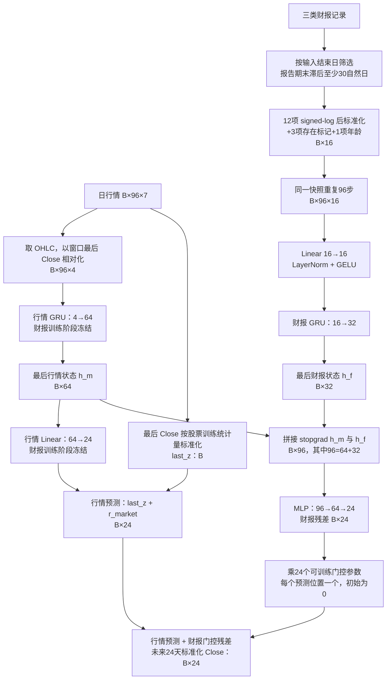
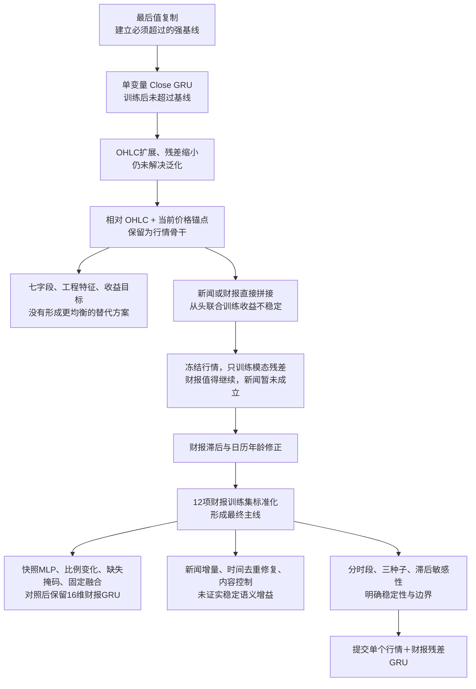

# 股票多模态预测：GRU 完整实验路径、最终架构与结果

> 用途：作为制作 PPT 和组织汇报的详细素材，不再限定汇报时长。正文使用具体模型和改动名称，内部实验编号仅保留在来源链接的路径中。本文在原讲稿文件上扩展，保留文件名，方便沿用已有链接。
>
> 整理依据：四份原始报告、GRU 系列结果 JSON，以及最终提交模型的实际实现。GRU 主线采用一致的时间切分；其他模型来自不同实验批次，用于说明研究过程，不作为严格控制变量的架构排行榜。

## 一、汇报的主线：最终方案是怎样形成的

本项目根据股票过去 **96 个交易日**的信息，预测未来 **24 个交易日**的收盘价。可以利用的信息包括日行情、新闻向量和结构化财报。

我们的研究并不是从一开始就确定采用多模态 GRU，而是逐步回答四个问题：

1. **只看历史价格，能否超过最后值复制？** 从单变量 GRU 出发，比较不同输入表示、残差幅度和预测目标。
2. **更多字段、注意力或更复杂的模型，是否自然带来更好效果？** 比较七字段行情、线性模型、PatchTST 和 iTransformer。
3. **新闻和财报是否提供价格之外的增量？** 从直接拼接联合训练，转向冻结行情骨干、只学习辅助模态修正。
4. **观察到的提升是否可靠？** 检查财报缩放、时间滞后、缺失掩码、新闻内容控制、多个随机种子和不同时段。

最终保留的模型是：**以相对 OHLC 的单层 GRU 为固定行情骨干，用经过时间筛选与训练集标准化的财报分支，学习逐预测步的价格残差修正。** 新闻没有进入最终提交模型。

当前提交的单模型在本地留出集上的 MAE / MSE 为 **0.337790 / 0.310866**，最后值复制为 **0.354286 / 0.330340**，分别降低约 **4.66% / 5.90%**。同一冻结行情骨干下，财报分支三个随机种子的平均指标为 **0.334476 / 0.307854**；这是三次运行的分数均值，并不是提交了三模型集成。

适合汇报开场的表述：

> 我们最终的改进不来自不断加深网络，而来自三个环节：先用相对价格表示解决行情输入问题，再固定行情骨干隔离财报增量，最后把财报的时间与数值尺度处理正确。下面按照这条路径介绍尝试过程和最终架构。

## 二、任务、数据与评价尺度

### 2.1 数据规模与张量形状

| 项目 | 数据规模或形状 | 含义 |
| --- | --- | --- |
| 股票数量 | 810 只 | 不同股票的窗口共同训练一个共享模型 |
| 训练窗口 | 587,587 条 | 仅使用这一部分更新网络参数 |
| 官方验证窗口 | 76,950 条 | 进一步按时间划分为开发、边界排除和本地留出 |
| 原始日行情 | 单样本 `[96,7]` | Open、High、Low、Close、Volume、Dividends、Stock Splits |
| 最终行情输入 | 批量 `[B,96,4]` | 相对化后的 OHLC |
| 新闻向量 | 每篇 512 维 | 每只股票每天的篇数不固定，需要聚合后才能批量训练 |
| 原始财报 | 利润表、资产负债表、现金流量表 | 按股票和报告期保存的结构化记录 |
| 最终财报快照 | 单样本 `[16]` | 12 项数值、3 项类型存在标记、1 项报告年龄 |
| 最终财报网络输入 | 批量 `[B,96,16]` | 同一份快照重复 96 步 |
| 标签与预测 | 批量 `[B,24]` | 未来 24 个交易日的标准化 Close |

这里的 `B` 是 batch size。96 和 24 都是交易日长度；财报可用滞后使用的是自然日，两者不要混淆。

### 2.2 标签标准化与行情相对化是两件不同的事

对股票 `s`，训练期收盘价固定统计量记作 `μ_s、σ_s`：

```text
y[s,h] = (未来第 h 天的 Close - μ_s) / σ_s
last_z = (输入最后一天的 Close - μ_s) / σ_s
```

`μ_s、σ_s` 来自该股票的训练期，**不是每个 96 天窗口重新计算**。同一股票的不同样本共用这一组统计量，开发和留出阶段也沿用它们。

最终模型的行情输入则是：

```text
x[t,k] = OHLC[t,k] / 输入最后一天的原始 Close - 1
```

前者规定预测与评分的尺度，后者描述窗口内价格相对当前位置的形状。模型使用相对 OHLC 作为序列输入，同时单独保留 `last_z` 作为输出锚点。因此，输入最后一天的相对 Close 虽然为 0，并不会丢失预测需要的当前价格位置。

例如，输入最后收盘价为 10 元、某天开盘价为 9.5 元，该开盘价输入是 `-0.05`。若该股票训练期均值为 8 元、标准差为 2 元，则 `last_z=1`。预测输出为 1.1 时，还原价格是 `8+2×1.1=10.2` 元。

本报告的 MAE、MSE 都在标准化 Close 尺度上计算，**不是元，也不是收益率百分比**。

### 2.3 时间切分与选择规则

| 数据部分 | 样本数 | 预测起始日范围 | 用途 |
| --- | ---: | --- | --- |
| 开发验证 | 42,930 | 2023-10-09～2023-12-20 | 早停、选检查点、调整超参数 |
| 边界排除 | 18,630 | 2023-12-21～2024-01-23 | 排除未来标签会跨入留出时期的窗口 |
| 本地留出 | 15,390 | 2024-01-24～2024-02-27 | 最佳检查点确定后的后段时间评估 |

开发窗口的未来标签最晚到 2024-01-23，早于留出集第一个预测日。历史输入可以重叠，主要隔离的是未来标签。表中的日期是预测起始日范围，不是全部未来标签的覆盖范围。

本地留出没有参与每轮早停，但研究过程中已经反复查看，也影响了后续实验方向。因此它可以提供后段时间表现的证据，不能再称为完全独立的盲测，更不能等同于官方隐藏测试集。

### 2.4 训练损失与模型选择

```text
MAE  = 所有样本、所有 24 个预测位置上的平均绝对误差
MSE  = 所有样本、所有 24 个预测位置上的平均平方误差
loss = MAE + 0.2 × MSE
```

MAE 提供较直接的平均偏差约束，MSE 加重对大误差的惩罚。`0.2` 是训练权重，不表示 MSE 固定占总损失的 20%；两部分实际贡献会随误差变化。也不能据此认定官方评分使用相同加权公式。

主要 GRU 实验按开发 MAE 选择最佳训练后检查点，训练结束后重新加载它，再评估本地留出。初始化结果用于诊断；后续主要 GRU 对照要求选择真正训练过的轮次，因此即使保存了“最优训练检查点”，它也可能差于初始化基线。

## 三、先建立强基线：为什么最后值复制难以超过

最后值复制的做法非常简单：把输入最后一天的标准化收盘价，原样复制到未来 24 天。

```text
预测 = [last_z, last_z, ..., last_z]    # 24 个位置
```

移动平均则对输入末尾 5、10 或 20 天的 Close 求一次均值，再复制到未来 24 天；不会使用预测期的真实价格，也不是边预测边加入未来真实值。

| 无训练方法 | 开发 MAE | 开发 MSE | 留出 MAE | 留出 MSE |
| --- | ---: | ---: | ---: | ---: |
| **最后值复制** | **0.217307** | **0.131206** | **0.354286** | **0.330340** |
| 过去 5 日均值 | 0.230412 | 0.142225 | 0.378627 | 0.358666 |
| 过去 10 日均值 | 0.246450 | 0.155649 | 0.392914 | 0.381531 |
| 过去 20 日均值 | 0.275334 | 0.180933 | 0.406871 | 0.414519 |

这一步的重要发现是：平滑历史价格不一定更好。短期未来价格往往仍与当前价格接近，使用更长均值可能引入滞后。因此后面的学习模型始终保留当前收盘价锚点，只学习相对它的修正。

最后值很强，也解释了为什么“训练损失下降”不等于“模型有用”。一个模型可以很好地拟合训练期波动，却在验证期输出多余的价格修正，反而不如保持不变。

## 四、并行探索：为什么最终把 GRU 作为主线

我们也尝试了其他模型，分别检查不同的建模假设。这些工作不是最终汇报的主体，但需要保留，说明模型选择经过了比较。

### 4.1 DLinear：先看线性趋势是否足够

DLinear 用时间序列分解和线性映射预测未来，参数少、易训练。相关路线进一步尝试窗口中心化、L2 正则，以及让远近预测步采用不同残差收缩幅度。

增强 DLinear 的固定三种子平均预测达到开发 **0.216052 / 0.130342**、留出 **0.351294 / 0.324072**；另一组平稳化 DLinear 的留出为 **0.350345 / 0.320201**。它们表明简单模型也能获得小幅改善，不能认为复杂架构才有价值。

但这些尝试没有在各自开发、留出和复验条件下形成足以替代最终行情＋财报 GRU 的证据。汇报中应把它作为“低容量模型和残差收缩值得比较”的背景。

### 4.2 PatchTST：用局部时间片建模价格形态

PatchTST 把长序列切成若干 patch，再用注意力学习片段之间的关系。早期 Close-only 版本的开发 MAE 为 **0.237654**，调整学习率和正则后为 **0.238251**，仍差于最后值复制。

另一批实验继续调整残差收缩、选轮方式、宽度和 dropout，优化版本的固定三种子平均预测达到开发 **0.215004 / 0.129781**、留出 **0.353688 / 0.328020**。因此不能笼统说 PatchTST 完全无效；更准确的是，它在已尝试设置中改善有限，没有成为最终方案。

### 4.3 iTransformer：变量间关系能否提供额外收益

iTransformer 把变量作为 token，重点学习价格、成交量等变量之间的关系。所查报告中的默认配置约 28.2 万参数，使用 10 维行情特征。

这一配置允许把 epoch 0 作为候选，最终选择了零残差初始化，等价于最后值复制。实际训练后的开发 MAE 从第 1 轮的 **0.230713** 上升到第 3 轮的 **0.254875**，而训练损失继续下降。缩小模型、降低学习率和加强正则的对照也没有解决该批次的泛化问题。

这说明这些设置下注意力模型没有学到可泛化的增量，不能据此证明所有 Transformer 都不适合股票。

### 4.4 其他模态与频域探索提供的启发

其他报告也尝试了新闻均值池化、财报比例特征，以及轻量的 SpecTF 风格频域融合。当前记录没有提供可靠的升级证据。其中频域模型是借鉴思路的轻量实现，不应描述为完整复现论文后否定论文效果。

这些比较共同推动我们改变研究重点：**先把较小的行情模型做扎实，再独立检验辅助信息。** GRU 被保留是因为它在当前路线中形成了较清楚的输入改进、财报增量和多种子证据，并不代表已经完成所有架构的同预算最优比较。

## 五、GRU 阶段一：单变量模型为什么不够

### 5.1 初版架构

第一版只输入标准化 Close，使用单层、单向、64 维隐藏状态的 GRU：

```text
标准化 Close [B,96,1]
    → GRU(input=1, hidden=64)
    → 最后隐藏状态 [B,64]
    → Linear(64→24)
    → 未来 24 步残差 [B,24]

预测 = last_z + 残差
```

预测头零初始化，模型在训练开始时等于最后值复制。这样不必重新学习当前价格水平，而是从强基线出发学习未来变化。

### 5.2 GRU 在这里具体做什么

GRU 按顺序读取 96 天，每一步结合当天输入和前一天隐藏状态，更新内部表示。更新门控制旧状态与新候选状态的混合，重置门控制计算候选状态时使用多少旧信息。读完第 96 天后，最后状态压缩了该窗口的历史信息。

这里没有逐日生成未来：模型通过一个线性头**一次性输出 24 个预测位置**，不是先预测第 1 天，再把预测值喂回网络得到第 2 天。因此没有自回归反馈造成的逐步误差累积，但多个预测位置也没有显式的逐日递推约束。

GRU 内部的更新门、重置门，和后面财报残差上的 24 个输出门控参数，是两套不同机制。

### 5.3 结果与下一步假设

初版的开发 MAE / MSE 为 **0.241438 / 0.167650**，留出为 **0.398728 / 0.438897**，明显差于最后值基线。另一次历史运行结论相近，但不能把这两份记录当作规范的多种子统计。

这时的问题不是“GRU 能不能跑”，而是它学到的修正能否跨时期泛化。我们优先检查输入表达和输出幅度，而不是直接把单层 GRU 加深。

## 六、GRU 阶段二：从绝对价格位置转向相对价格形态

### 6.1 扩展到 OHLC：增加每日价格形态

只输入 Close 可能遗漏日内波动信息，因此先扩展为 Open、High、Low、Close 四个字段，仍用该股票训练期 Close 的均值和标准差变换价格。

网络保持 `GRU(4→64) + Linear(64→24)`，输出仍是 `last_z + residual`。这一版开发 MAE 为 **0.242969**，没有改善。

这说明增加价格字段本身不够，模型仍可能过多依赖训练期的价格位置，而没有学到稳定的局部变化。

### 6.2 缩小残差：检查是否修正过度

下一步保持输入和网络不变，把学习残差固定乘以 0.1：

```text
预测 = last_z + 0.1 × 网络残差
```

留出 MAE 从 **0.399845** 降至 **0.384907**，但开发 MAE 为 **0.243162**，仍未超过最后值。这支持“过强修正可能有害”的判断，但缩放本身没有解决输入与泛化问题。

### 6.3 关键变化：以窗口最后收盘价相对化 OHLC

随后改成：

```text
relative_OHLC[t] = OHLC[t] / 输入最后一天的原始 Close - 1
预测 = last_z + Linear(GRU(relative_OHLC) 的最后状态)
```

与前面相比，网络规模没有明显变化，主要改变的是输入所表达的信息。GRU 不必直接面对不同股票的绝对价格水平，而是读取“过去各天相对当前价格高了或低了多少”。价格水平由独立的 `last_z` 保留，价格形态交给 GRU 学习。

开发 MAE / MSE 降至 **0.213222 / 0.128779**，最佳检查点在第 2 轮，成为后续冻结使用的行情骨干。不过留出 **0.358988 / 0.336930** 仍略差于最后值，因此不能说纯行情问题已经解决。

可以把这一步概括为：**把价格位置与局部形态分开表达，比继续增加网络复杂度更有效。** 这是当前对照支持的解释，不等于已经证明跨股票价格差异是此前失败的唯一原因。

### 6.4 改预测目标：未来相对收益是否更自然

保持相对 OHLC 输入，另一个版本改为学习：

```text
return[h] = future_Close[h] / input_last_Close - 1
预测价格[h] = input_last_Close × (1 + predicted_return[h])
标准化预测[h] = (预测价格[h] - μ_s) / σ_s
```

它的开发 MAE 为 **0.212324**，低于相对 OHLC 的标准化 Close 版本，但开发 MSE 和留出指标都变差。最终保留标准化 Close 残差目标。

由于两者训练目标尺度不同，不能只比较日志中的训练 loss 大小；应先换回共同的标准化 Close 尺度再评价。

### 6.5 这一阶段的完整对照

| 变化 | 开发 MAE | 开发 MSE | 留出 MAE | 留出 MSE |
| --- | ---: | ---: | ---: | ---: |
| 单变量标准化 Close | 0.241438 | 0.167650 | 0.398728 | 0.438897 |
| 股票统计量标准化 OHLC | 0.242969 | 0.168926 | 0.399845 | 0.440116 |
| 上述模型残差乘 0.1 | 0.243162 | 0.158174 | 0.384907 | 0.387999 |
| **相对 OHLC，标准化 Close 残差** | **0.213222** | **0.128779** | **0.358988** | **0.336930** |
| 相对 OHLC，预测未来相对收益 | 0.212324 | 0.129458 | 0.363267 | 0.341936 |

汇报时不应把这一过程讲成“每次调整都更好”。真正被保留的是相对 OHLC 表示；增加字段、减小修正和更换目标都提供了诊断，但没有全部成为最终组件。

## 七、GRU 阶段三：七字段与工程特征为什么没有保留

在确定相对 OHLC 骨干后，我们继续检查成交量、分红和拆股是否能补充价格信息。

第一组直接使用七个行情字段，并进行必要缩放：价格使用股票训练期统计量，Volume 先 `log1p` 再按输入窗口标准化，分红按价格尺度处理。

第二组改为七维工程特征：对数收益、振幅、K 线实体幅度、标准化 log-volume、分红事件、拆股事件，以及标准化 Close。

| 行情输入方案 | 开发 MAE | 开发 MSE | 留出 MAE | 留出 MSE |
| --- | ---: | ---: | ---: | ---: |
| 相对 OHLC | 0.213222 | 0.128779 | 0.358988 | 0.336930 |
| 七个原始字段及必要缩放 | 0.243534 | 0.167583 | 0.407071 | 0.442811 |
| 七维平稳化工程特征 | 0.242097 | 0.175410 | 0.408806 | 0.469720 |

两组都未超过相对 OHLC。但它们同时改变了价格输入表示，因此这不是“只添加成交量”的严格消融，不能据此认定成交量没有任何价值。

这一阶段的取舍是：保留已经验证较好的四维相对 OHLC，避免同时改变过多因素。历史上还有七字段模型选中 epoch 0 的记录，其分数实际等于最后值复制，不能当作训练后成功的证据。

## 八、GRU 阶段四：从直接融合到冻结骨干

### 8.1 第一种融合：把辅助信息拼到每日行情后一起训练

新闻版本先对每天文章向量取均值，将 512 维投影到 16 维，加上新闻是否存在与数量信息，再与当天四维相对 OHLC 拼接：

```text
新闻日均值 512维 → 投影16维
行情4维 + 新闻16维 + 存在/数量2维 = 每天22维
    → GRU(22→64) → 24步残差
```

财报版本把 16 维快照投影到 16 维，与四维行情拼接为每天 20 维，再进入 GRU。

这两组都是从头联合训练融合模型，沿用相对 OHLC 的思想，**并没有加载并冻结行情最佳权重**。

| 联合训练方式 | 开发 MAE | 开发 MSE | 留出 MAE | 留出 MSE |
| --- | ---: | ---: | ---: | ---: |
| 仅相对 OHLC 行情 | 0.213222 | 0.128779 | 0.358988 | 0.336930 |
| 行情＋每日新闻 | 0.219304 | 0.132981 | 0.364273 | 0.340276 |
| 行情＋财报快照 | 0.213713 | 0.128775 | 0.362031 | 0.339152 |

新闻没有改善，财报开发 MSE 仅有很小变化，留出也没有提升。这不能直接判定辅助模态无效，因为联合训练同时改变了行情编码器；最终误差混合了行情分支变化和新增模态贡献。

### 8.2 第二种融合：冻结行情，只训练增量分支

为更清楚地检查辅助模态，我们加载同一个相对 OHLC 最佳检查点，冻结行情 GRU 和价格预测头。

新闻或财报由独立编码器处理，再与行情隐藏状态拼接，输出一个 24 维修正量。修正量经过从零开始的逐预测步门控，加到固定的行情预测上。

```text
固定行情模型 → 行情预测 ──────────────────────┐
固定行情状态 + 辅助模态状态 → MLP → 门控残差 ──┴→ 最终预测
```

这种设计让实验问题变成：“在同一个行情模型上，辅助模态能否带来增量？”它固定了行情分支参数，但**不能保证总预测不退化**，因为新增残差仍可能学到错误修正。

### 8.3 新闻、财报和双分支的对照

新闻分支采用每日文章的 mean＋max，共 1024 维，再投影和 GRU 编码；财报分支使用最新快照。双分支版本联合训练两个适配器，行情始终冻结。

| 冻结行情后的增量方案 | 开发 MAE | 开发 MSE | 留出 MAE | 留出 MSE |
| --- | ---: | ---: | ---: | ---: |
| 仅新闻残差 | 0.219360 | 0.131953 | 0.358719 | 0.334871 |
| 仅财报残差 | 0.216988 | 0.130395 | 0.349297 | 0.326557 |
| 新闻＋财报两个残差分支 | 0.230023 | 0.139585 | 0.353564 | 0.328866 |

新闻仍未改善开发表现。财报在留出段出现收益，但开发指标仍差于纯行情，说明值得检查数据处理，而不能立即宣称已经得到稳定增量。同时加入两个模态进一步恶化开发表现，多模态数量本身并不是优势。

## 九、GRU 阶段五：财报处理成为主要改进来源

### 9.1 先修正可用时间和报告年龄

财报中的 `end_date` 是**报告期末**，不是实际公告时间。例如 3 月 31 日期末的报告，并不代表在 3 月 31 日就能拿到。

因此，我们把快照筛选改为：

```text
报告期末 <= 输入结束日 - 30 个自然日
```

同时把报告年龄改为真实日历天数，再计算 `log1p(age)`。不能直接用 `20240401 - 20240331` 这种日期编码相减来表示过去了多少天。

这一步把留出 MAE 从 **0.349297** 改善到 **0.347855**，开发 MAE 从 **0.216988** 改善到 **0.216775**。由于同时改了滞后和年龄计算，这不是严格只改 0 天与 30 天的单因素实验。

30 天是一个可用性近似，并不保证所有报告已经公开；也不是把报告影响“向前移动”。模型仍只使用输入结束时按规则允许取得的历史报告。

### 9.2 再处理数值尺度：signed-log 不等于标准化

财报的 12 项数值具有不同单位和分布，有的大、有的小，还有负利润和负现金流。先使用：

```text
signed_log(x) = sign(x) × log(1 + abs(x))
```

这样压缩极端值，并保留负数方向。但压缩后不同字段的均值、波动范围仍不同，因此继续做逐字段标准化：

```text
financial_z[j] = (signed_log(value[j]) - mean_train[j]) / std_train[j]
```

这组 12 维均值与标准差，只使用训练输入截止条件允许的历史财报快照，按字段跨股票计算；开发和留出沿用同一组统计量。它不是每只股票一组，也不是每个窗口重算，与标签的 `close_mean、close_std` 完全不同。

| 统计量 | 统计对象 | 作用 |
| --- | --- | --- |
| 每只股票的 Close 均值、标准差 | 该股票训练期收盘价 | 定义标签与最后值锚点的尺度 |
| 每个财报字段的均值、标准差 | 训练期允许使用的跨股票财报快照，先 signed-log | 让财报各数值字段具有较合适的输入尺度 |

加入这一步后，开发为 **0.213464 / 0.127426**，留出为 **0.337790 / 0.310866**，最佳财报分支检查点在第 8 轮。这是财报主线中最明显的改进之一。

### 9.3 财报改进过程的直接对照

| 财报处理方式 | 开发 MAE | 开发 MSE | 留出 MAE | 留出 MSE |
| --- | ---: | ---: | ---: | ---: |
| 冻结行情＋原始财报适配器 | 0.216988 | 0.130395 | 0.349297 | 0.326557 |
| 加 30 天滞后＋真实日历年龄 | 0.216775 | 0.130099 | 0.347855 | 0.325371 |
| **再加 12 项财报数值训练集标准化** | **0.213464** | **0.127426** | **0.337790** | **0.310866** |

汇报时应突出：这一阶段**主要修改的是输入处理，残差融合架构基本相同**。它提供的证据是“正确的时间与尺度处理重要”，不是“加一个财报 GRU 就自然有效”。

## 十、最终模型架构：行情骨干＋财报残差适配器

### 10.1 整体结构图



注意图中有两种完全不同的“96”：行情和财报序列的 96 是历史步数；拼接后的 96 是 `64+32` 个特征维度。

### 10.2 分支一：固定的行情 GRU

| 层或变量 | 形状 | 功能 |
| --- | --- | --- |
| 相对 OHLC | `[B,96,4]` | 表达过去价格相对当前价格的变化形态 |
| 行情 GRU | 输入 4，隐藏 64 | 单层、单向编码 96 天行情 |
| 最后行情状态 `h_m` | `[B,64]` | 行情窗口的紧凑表示 |
| 行情线性头 | `64→24` | 一次性产生未来 24 步价格残差 |
| `last_z` 广播后 | `[B,1]` | 加到每个预测位置，保留当前价格水平 |
| 行情预测 | `[B,24]` | `last_z + market_head(h_m)` |

同一套参数用于全部股票，当前最终模型没有为每只股票设置独立网络。跨股票价格差异主要通过相对 OHLC 输入和每股票标签统计量处理。

### 10.3 分支二：16 维财报快照如何构成

| 来源 | 4 项数值字段 | 对应信息 |
| --- | --- | --- |
| 利润表 | `total_revenue`、`operate_profit`、`n_income`、`basic_eps` | 营业总收入、营业利润、净利润、基本每股收益 |
| 资产负债表 | `total_assets`、`total_liab`、`total_hldr_eqy_inc_min_int`、`money_cap` | 总资产、总负债、含少数股东权益的股东权益、货币资金 |
| 现金流量表 | `n_cashflow_act`、`n_cashflow_inv_act`、`n_cash_flows_fnc_act`、`free_cashflow` | 经营、投资、筹资现金流净额与自由现金流 |
| 辅助特征 | 三类报告存在标记、`log1p(报告年龄)` | 快照完整性和新鲜程度 |

共 `12+3+1=16` 维。基本每股收益与金额字段的单位不同，因此更准确的说法是“12 项财报数值指标”，不要统称为 12 个金额。

快照选择按以下步骤进行：

1. 以输入最后日期为基准，减去 30 个自然日，得到报告期末筛选阈值。
2. 在三类报表的候选记录中，找到不晚于该阈值的最新报告期。
3. 在这个报告期内分别取各类记录；同类同报告期有多条时取文件顺序最后一条。某类缺失时，不自动回退到这一类的更旧报告期。
4. 提取 12 项数值，做 signed-log 和训练集标准化，再拼接存在标记与真实日历年龄。
5. 把同一份快照复制为 `[96,16]`。

缺失或无效字段在 signed-log 阶段用 0 表示，随后仍按该字段统计量标准化，因此输入值未必还是 0。若根本没有任何可用报告，整个财报输入为零。当前模型没有“无财报就强制残差为零”的硬规则，零输入仍可能经网络产生修正。

这里的快照是以**窗口结束时**为基准选择的。重复到历史 96 步是编码方式，不代表这份快照在窗口最早一天就已经公开，也不代表读到了 96 份逐日报告。

### 10.4 财报编码器与融合头

```text
重复快照 [B,96,16]
    → Linear(16→16)
    → LayerNorm(16)
    → GELU
    → GRU(input=16, hidden=32)
    → h_f [B,32]

concat(stopgrad(h_m), h_f) [B,64+32]
    → Linear(96→64)
    → GELU
    → Dropout（当前配置为0）
    → Linear(64→24)
    → financial_delta [B,24]
```

财报头同时读取行情状态和财报状态，而不只根据财报独立预测。这允许相同财务信息在不同价格形态下产生不同修正；这是结构提供的能力，不是已经验证的可解释经济机制。

虽然财报快照重复输入 GRU，但它并没有真实的季度演进序列。后续也用单次快照 MLP 做过对照，两者分数接近，所以不能宣称 GRU 对静态快照必不可少。

### 10.5 输出公式与门控含义

```text
h_m = market_GRU(relative_OHLC) 的最后状态
h_f = financial_GRU(projection(repeated_snapshot)) 的最后状态

r_market = market_head(h_m)
r_fin    = financial_head(concat(stopgrad(h_m), h_f))

prediction[h] = last_z + r_market[h] + gate[h] × r_fin[h]
```

`gate` 有 24 个参数，对未来每个预测位置各一个，在所有股票和样本间共享。它们是可正可负的自由参数，**不是 sigmoid 限制的 0～1 权重，也不是按样本动态计算的注意力分数**。

门控初始化为 0，财报分支刚接入时，整个模型精确等于原行情骨干。训练后门控和残差头共同决定修正幅度。但零初始化只保证起点一致，不保证训练后一定更好，也不保证不同位置的门控绝对值能直接解释为财报重要性。

### 10.6 实际训练是分阶段完成的

| 阶段 | 加载或初始化 | 更新参数 | 选择依据 |
| --- | --- | --- | --- |
| 行情预训练 | 相对 OHLC GRU，价格头零初始化 | 行情 GRU 与价格头 | 开发 MAE，历史最佳为第 2 轮 |
| 财报增量训练 | 加载固定行情最佳权重，财报门控从零开始 | 财报投影、财报 GRU、融合 MLP、24 个门控 | 开发 MAE，提交版本最佳为第 8 轮 |
| 推理 | 加载已训练权重及财报统计量 | 不更新参数 | 输出 `[B,24]` |

主要配置是 AdamW，学习率 `3e-4`，weight decay `1e-5`，batch size 256，最多 20 轮，patience 6，梯度裁剪 1.0。早停只是停止继续训练；最终评估的是保存的最佳轮次，而不是最后停止的那一轮。

复现实验应使用行情与财报的对应实验训练入口。根目录提交文件中的简化训练辅助入口，不等于历史实验的两阶段冻结训练协议。

## 十一、在最终方案附近，我们还尝试了哪些改动

### 11.1 财报 GRU 换成单快照 MLP

由于财报输入实际是一份重复快照，我们用 MLP 编码单个 `[B,16]` 快照，得到 32 维表示，再与 64 维行情状态拼接，保留残差输出思路。

开发结果为 **0.214011 / 0.127680**，留出为 **0.339175 / 0.311612**，比财报 GRU 略差但很接近。当前保留 GRU，理由是已有结果稍好且完成后续验证，而不是已经证明快照一定存在 GRU 才能学习的时间依赖。

### 11.2 增加财务比例和相邻报告期变化

把 16 维扩成 35 维：12 项原值、7 项比例、12 项相邻期变化、3 项报告存在标记、1 项年龄。

开发为 **0.216984 / 0.131445**，留出为 **0.344267 / 0.312536**，没有改善。一个待排查的问题是：收入和现金流可能使用年内累计口径，直接比较相邻报告期，会混入累计时长与季节性差异。

结论只针对这组特征构造，不是否定财务比例。下一步需要先统一累计与单季度口径，再构造少量有明确含义的同比、利润率或现金流指标。

### 11.3 增加字段缺失掩码

原先缺失与真实零值共用编码，因此增加 12 个逐字段存在标记，把财报输入扩到 28 维，重新训练财报适配器。

单次留出达到 **0.335860 / 0.309352**，看起来略优于最终模型；但开发为 **0.214254 / 0.127758**，反而更差。进一步三种子对照没有稳定复现这个留出优势，因此没有采用。

### 11.4 行情预测与财报预测固定比例融合

在开发集搜索固定权重后，选中两者各占一半：

```text
融合预测 = 0.5 × 纯行情预测 + 0.5 × 行情财报预测
```

由于两者共享同一个行情骨干，这实质上是把财报修正缩小一半，不一定是两个独立模型的互补集成。

它的开发为 **0.211871 / 0.127187**，开发 MAE 是这些候选中更低的，但留出退化为 **0.346112 / 0.322019**。因此最终方案不是所有指标上的绝对最低分；我们综合开发、后段时间与多种子结果，保留标准化财报 GRU。这个选择也说明本地留出已进入研究决策，后续仍需新的独立测试。

### 11.5 相近候选汇总

| 候选改动 | 开发 MAE | 开发 MSE | 留出 MAE | 留出 MSE | 当前取舍 |
| --- | ---: | ---: | ---: | ---: | --- |
| **标准化财报 GRU** | **0.213464** | **0.127426** | **0.337790** | **0.310866** | 保留为提交方案 |
| 单快照 MLP | 0.214011 | 0.127680 | 0.339175 | 0.311612 | 接近，但未超过 |
| 比例与变化特征 | 0.216984 | 0.131445 | 0.344267 | 0.312536 | 暂不采用 |
| 增加字段缺失掩码 | 0.214254 | 0.127758 | 0.335860 | 0.309352 | 单次留出好，多种子未稳定胜出 |
| 两预测各占一半 | 0.211871 | 0.127187 | 0.346112 | 0.322019 | 开发好，留出退化 |

## 十二、新闻为何没有进入最终模型：经过了两轮诊断

### 12.1 在完整行情＋财报模型上增加新闻分支

为避免新闻破坏已经学好的财报编码器，我们进一步冻结整个行情＋财报模型，只训练新闻适配器；新闻编码分支从已有新闻模型初始化，输出门控重新置零。

最佳训练轮次为第 1 轮，开发 **0.227625 / 0.136840**，留出 **0.340911 / 0.311792**，均未超过基座。这个结果说明该新闻分支泛化不足，但不能仅据此判断是 GRU 层数问题，或新闻绝对没有信息。

### 12.2 修正时间归属和去重，再用低容量残差检验

随后不再扩大新闻网络，改做更容易诊断的低容量对照：

- 同一股票同一 `vector_id` 只保留最早记录，解决重复向量反复计入的问题；这不是语义相似文本去重。
- 新闻归到不早于发布时间的第一个交易日截止点，周末新闻可进入下一交易日。默认截止点为 23:59:59，包含盘后信息，因此不能表述为收盘时刻即可预测。
- 仅用训练新闻拟合 PCA，将 512 维压到 16 维。
- 分别聚合最近 1、5、20 个交易日的内容均值、数量、覆盖和新鲜度，形成真实内容 57 维、纯元信息 9 维。
- 使用 Ridge 学习固定行情＋财报模型的残差，无近期新闻时修正为零，并设置打乱新闻内容的控制组。

| 新闻控制实验 | 开发 MAE | 开发 MSE | 留出 MAE | 留出 MSE |
| --- | ---: | ---: | ---: | ---: |
| 行情＋财报基座 | 0.213464 | 0.127426 | 0.337790 | 0.310866 |
| 仅数量、覆盖、新鲜度 | 0.215239 | 0.128091 | 未评估 | 未评估 |
| 真实新闻内容＋元信息 | 0.215319 | 0.128087 | 0.333942 | 0.306331 |
| 打乱新闻内容＋元信息 | 0.215270 | 0.128097 | 未评估 | 未评估 |

真实新闻的单次留出更好，但开发表现没有超过基座，也没有超过元信息和打乱内容控制。这不足以支持“新闻语义有可靠增量”，因此没有为单个较好的留出分数继续扩大新闻模型。

这一轮同时修改了时间归属、去重、聚合方式和拟合模型，不能把结果单独归因于某一个修复步骤。汇报中的准确结论是：**当前新闻表示与利用方式尚未显示稳定内容增益，最终优先保留行情和财报。**

## 十三、稳定性验证：避免只相信一次较好的分数

### 13.1 不同时段的检查

已有“滚动验证”脚本实际上是：用同一个已训练检查点，在开发集三个连续时间段分别评价，**没有每段重新训练**。

| 预测起始日范围 | 最后值 MAE | 纯行情 GRU MAE | 最终行情＋财报 GRU MAE |
| --- | ---: | ---: | ---: |
| 2023-10-09～2023-11-01 | 0.223778 | 0.222987 | 0.221624 |
| 2023-11-02～2023-11-27 | 0.197989 | 0.195288 | 0.200507 |
| 2023-11-28～2023-12-20 | 0.230909 | 0.221869 | 0.218532 |

财报不是每一段都带来改善：第一、第三段好一些，中间段反而差。这提示模型收益可能依赖时期，不能只报告总体平均值。

这些检查点本来就由整个开发集选出，且相邻窗口的未来标签重叠，所以不能把三段当作三次独立测试。严格的 walk-forward 验证还需要按时间推进重新训练、重新选轮，再评估下一时期。

### 13.2 三个随机种子：标准财报与缺失掩码的配对比较

我们沿用同一个冻结行情骨干，改变财报分支的初始化和训练样本顺序。结果如下，标准差为样本标准差：

| 财报方案 | 开发 MAE 均值 ± 标准差 | 开发 MSE 均值 ± 标准差 | 留出 MAE 均值 ± 标准差 | 留出 MSE 均值 ± 标准差 |
| --- | --- | --- | --- | --- |
| **16 维标准化财报** | **0.213448 ± 0.000322** | **0.127347 ± 0.000080** | **0.334476 ± 0.002902** | **0.307854 ± 0.002673** |
| 28 维财报＋字段掩码 | 0.214305 ± 0.000310 | 0.128278 ± 0.000534 | 0.337677 ± 0.003981 | 0.311720 ± 0.004923 |

16 维方案在三个种子的开发 MAE、MSE 比较中都更好；缺失掩码只在一个种子的留出上胜出，因此单次改善不足以支持替换。

16 维方案的三种子分数均值，相对最后值复制的开发 MAE / MSE 约降低 **1.78% / 2.94%**，留出约降低 **5.59% / 6.81%**。

这只是初步稳定性检查，不是统计显著性证明，也没有覆盖重新训练行情骨干的随机性。不能说我们已经验证了完整两阶段模型在所有随机性下都稳定。

### 13.3 财报滞后敏感性：30、60、90 个自然日

| 财报期末滞后 | 开发 MAE | 开发 MSE | 留出 MAE | 留出 MSE |
| --- | ---: | ---: | ---: | ---: |
| **30 天** | **0.213464** | **0.127426** | **0.337790** | **0.310866** |
| 60 天 | 0.214025 | 0.128889 | 0.348994 | 0.325355 |
| 90 天 | 0.216248 | 0.129508 | 0.349029 | 0.324620 |

30 天复用原结果，60、90 天重新拟合对应训练期财报统计量并训练财报分支。当前结果支持保留 30 天，不支持换成更旧报告。

但 0 天没有在相同标准化配置下重训，旧的无滞后实验还存在标准化和年龄计算差别，不能拿来作严格的 0 对 30 天消融。30 天分数最好，也不代表它就是真实公告日期。

## 十四、把长期尝试压成一条清楚的实验路径



图中箭头表示研究依赖，不表示每一步都提高分数。

| 阶段 | 当时要解决的问题 | 主要改变 | 从结果得到的取舍 |
| --- | --- | --- | --- |
| 强基线 | 学习模型是否值得做 | 最后值、不同窗口移动平均 | 最后值最强，后续保留当前价锚点 |
| 初版 GRU | 历史 Close 能否预测变化 | 单变量 GRU、直接 24 步残差 | 训练可运行，但泛化不足 |
| 输入改进 | 是否被价格尺度和位置影响 | OHLC、残差收缩、窗口相对化 | 相对 OHLC 成为关键改进 |
| 输入与目标对照 | 更多信息或收益目标是否更好 | 七字段、平稳化、相对收益目标 | 暂留四维相对 OHLC 与标准化 Close 目标 |
| 初次多模态 | 新闻或财报能否补充行情 | 每日特征拼接、联合训练 | 无稳定升级，需要隔离行情变化 |
| 冻结适配器 | 辅助信息是否有独立增量 | 固定行情，新增门控残差分支 | 财报有后段时间改善，继续处理 |
| 财报校正 | 信息何时可用、数值是否适合网络 | 滞后、日历年龄、训练集标准化 | 形成当前提交方案 |
| 附近消融 | 是否需要更复杂特征与融合 | MLP、比率变化、掩码、固定权重 | 单项好分不代表总体可靠 |
| 新闻诊断 | 内容是否真有增量 | 时间去重修复、低容量残差、打乱控制 | 现有新闻内容增益不成立 |
| 稳定性 | 是否依赖一次训练与某个时期 | 三种子、分时段、滞后敏感性 | 保留较简单方案，同时说明局限 |

## 十五、汇报用的核心成绩表

如果 PPT 只能放一张主结果表，建议使用下面这张。其他详细对照放在对应实验页或附录。

| 方案 | 开发 MAE | 开发 MSE | 留出 MAE | 留出 MSE |
| --- | ---: | ---: | ---: | ---: |
| 最后值复制 | 0.217307 | 0.131206 | 0.354286 | 0.330340 |
| 单变量 Close GRU | 0.241438 | 0.167650 | 0.398728 | 0.438897 |
| 相对 OHLC 行情 GRU | 0.213222 | 0.128779 | 0.358988 | 0.336930 |
| 冻结行情＋滞后财报 | 0.216775 | 0.130099 | 0.347855 | 0.325371 |
| **冻结行情＋标准化财报 GRU，提交单模型** | **0.213464** | **0.127426** | **0.337790** | **0.310866** |
| 同方案三种子分数均值 | 0.213448 | 0.127347 | 0.334476 | 0.307854 |

“提交单模型”是历史 seed 42、第 8 轮财报分支的权重，既不是三种子预测平均，也不是按留出分数重新挑选的另一个种子。根目录 `model.py` 实现相同的行情＋财报架构，提交权重为 `model.pt`；新闻不参与最终预测。

这张表想表达的不是最终模型每个单项都第一。纯行情模型单次开发 MAE 略低，固定融合的开发 MAE 更低，真实新闻残差的单次留出也更好；但这些方案各自存在其他指标退化或控制实验未通过的问题。

更稳妥的汇报结论是：**标准化财报残差 GRU 是当前证据下较均衡、经过多种子检查并已完成提交实现的方案。**

## 十六、可以直接用于 PPT 的页面安排

不按时长硬裁剪，建议按下面的逻辑拆页。内容较多时，把相近消融和详细指标放到附录，保留主线的因果关系。

| 页面主题 | 本页回答的问题 | 推荐内容或图 |
| --- | --- | --- |
| 任务与最终结论 | 我们在预测什么，最后用了什么 | 96→24；行情＋财报残差 GRU；核心留出成绩 |
| 数据与评价 | 输入有多大，分数是什么尺度 | 数据形状表、时间切分示意、标签公式 |
| 强基线 | 为什么不直接用复杂网络 | 最后值与移动平均对照 |
| 其他模型探索 | 是否比较过线性和注意力模型 | DLinear、PatchTST、iTransformer 的动机、代表结果与局限 |
| GRU 初版 | 网络最开始是什么样 | 单变量 GRU 结构和训练后退化 |
| 行情输入演进 | 第一处有效改进在哪里 | 标准化 OHLC→缩小残差→相对 OHLC；配输入例子 |
| 纯行情边界 | 为什么没有继续堆更多行情字段 | 七字段、工程特征、收益目标结果 |
| 融合方式演进 | 为什么从拼接改成冻结残差 | 联合训练与固定骨干的结构对比 |
| 财报改进过程 | 最主要增益来自哪里 | 滞后、日历年龄、signed-log＋标准化三步 |
| 最终整体架构 | 两条分支怎样协作 | 本文完整架构图，突出64＋32拼接与24步门控 |
| 最终特征与训练 | 具体输入、哪些层更新 | 16维快照组成、两阶段冻结训练、形状流转 |
| 附近消融 | 是否尝试过更复杂方案 | 快照MLP、比率变化、缺失掩码、固定融合 |
| 新闻负结果 | 为什么最后没有新闻 | 多轮加入尝试与真实/元信息/打乱控制 |
| 稳定性验证 | 提升是否只来自运气 | 三种子表、三时段表、滞后敏感性 |
| 主结果与后续 | 有什么可信结论，还缺什么 | 核心成绩表；真实公告时间、单季口径、严格时间推进验证 |

面向生成 PPT 的工具，建议明确要求：正文使用描述性名称；图上的形状与本文保持一致；不要把“重复财报快照”绘制为真实逐日报告流；不要把三种子分数均值绘制成已提交的集成模型。

## 十七、提问准备：解释模型选择和结果边界

### 为什么不用更多层 GRU，或者更大的 Transformer？

当前负结果首先指向输入表达、尺度和时期泛化，而不是容量不足。单变量和标准化 OHLC 的结果较差，相对化后在相近网络规模下明显改善；财报分支同样在结构基本不变时因标准化而受益。继续加深当然可以作为新对照，但现有证据不足以把它作为最优先方向。

### 财报为什么还要与行情状态拼接？

财报编码给出公司财务快照，行情状态给出当前窗口的价格形态。残差头同时读取二者，结构上允许修正依赖当前行情背景。我们没有完成“不拼接行情状态”的严格消融，因此不能声称已经单独证明拼接贡献了多少分数。

### 财报是静态快照，使用 GRU 是否不合理？

它不是对真实财报历史轨迹的序列建模，而是对重复快照的非线性编码。单快照 MLP 对照与它接近，说明简化是可行方向。当前保留 GRU 是依据已有成绩与验证完整度，不能把这一选择解释成证明静态财报必须有循环结构。

### 为什么最佳轮次很早，不强制训练满 20 轮？

训练轮数增多只保证更多优化步骤，不保证验证表现更好。模型可以继续降低训练 loss，同时拟合训练期噪声。早停保留开发集最好的训练检查点；后面是否偶尔更好需要预先设计长训练对照，而不是按期待忽略已观察的退化。

### 为什么加财报后开发 MAE 没有明显低于纯行情？

单次开发 MAE 的确略高，但开发 MSE 更低、后段留出两项更好，并有财报分支三种子检查支持。这个结果应描述为多项证据下的取舍，不能包装成在全部数据和指标上全面领先。

### 为什么最后值复制这么强，是否说明模型没意义？

短期价格的当前水平是很强的预测参照，难点在学习稳定的增量变化。最终模型没有放弃它，而是在它上面叠加行情与财报修正。改进幅度有限也需要如实呈现，误差下降不自动意味着可交易收益。

### 30 天滞后能证明没有未来信息吗？

不能。报告期末不等于公告日，后续修订也可能发生在更晚时间。固定滞后降低了直接使用报告期末的激进程度，但严格的历史可见性需要真实公告和修订时间。当前应把它列为数据限制。

### 为什么新闻单次留出分数更低却不用？

开发指标没有超过基座，而且真实内容没有优于元信息和打乱控制组。只凭一个后段分数采用它，可能放大对本地留出的选择偏差。当前证据不足以证明新闻语义具有稳定增量。

### 这些结果能保证官方隐藏测试表现吗？

不能。已有本地留出已经多次查看，且时间分布可能变化。分时段和多种子增加了证据，但仍需严格的时间推进重训验证以及新的未使用测试时期。

## 十八、来源与复现定位

下面保留技术文件索引，方便核对，不建议把内部路径直接搬到 PPT 正文。

| 内容 | 来源 |
| --- | --- |
| GRU完整结果与评价说明 | [技术对照总表](../docs/gru_experiments.md) |
| 原始GRU阶段汇报 | [GRU路线报告](gru_report.md) |
| PatchTST和早期模态尝试 | [局部片段模型与多模态报告](毛佳惟实验报告.md) |
| 变量注意力模型 | [iTransformer结果报告](RESULTS.md) |
| 线性、注意力、频域及其他GPU批次 | [综合实验路线与结果报告](实验路线与结果总报告_2026-11-02.md) |
| 数据规模、字段与任务 | [项目介绍](../docs/intro.md) |
| 时间切分 | [切分记录](../experiments/validation_split.json) |
| 最后值与移动平均 | [基线结果](../experiments/gru_e0/e0_val_results.json) |
| 单变量GRU | [初版结果](../experiments/gru_e2/results.json) |
| 相对OHLC骨干及其他输入目标对照 | [行情结果](../experiments/gru_e3/result.json)、[统一实现](../experiments/gru_e3/model.py)、[历史对照](../experiments/gru_e3/archive/) |
| 七字段输入 | [原字段结果](../experiments/gru_e6_a/result.json)、[工程特征结果](../experiments/gru_e6_b/result.json) |
| 拼接联合训练 | [新闻融合结果](../experiments/gru_e7/result.json)、[财报融合结果](../experiments/gru_e8/result.json) |
| 冻结骨干增量 | [新闻适配器](../experiments/gru_e9_1/result.json)、[财报适配器](../experiments/gru_e9_2/result.json)、[双分支](../experiments/gru_e9_3/result.json) |
| 时间处理与最终标准化 | [滞后财报结果](../experiments/gru_e10_a/result.json)、[标准化财报结果](../experiments/gru_e10_b/result.json)、[财报训练与特征代码](../experiments/gru_e10_b/train.py) |
| 最终架构与冻结加载 | [实验模型实现](../experiments/gru_e9_2/model.py)、[提交实现](../model.py) |
| 快照MLP、固定融合与财报扩展 | [快照MLP](../experiments/gru_e10_c/result.json)、[固定融合](../experiments/gru_e10_d/result.json)、[比例变化](../experiments/gru_e11/result.json)、[字段掩码](../experiments/gru_e14_a/result.json) |
| 新闻二次诊断 | [神经适配器结果](../experiments/gru_e12/result.json)、[时间去重与内容控制结果](../experiments/gru_e13/result.json) |
| 分时段与多种子 | [分时段记录目录](../experiments/gru_validation/)、[三种子汇总](../experiments/gru_e15/summary.md) |
| 滞后敏感性 | [滞后对照汇总](../experiments/gru_e14_b/summary.md) |

本文只整理现有实现与结果，没有重新训练，也没有修改提交模型和权重。
