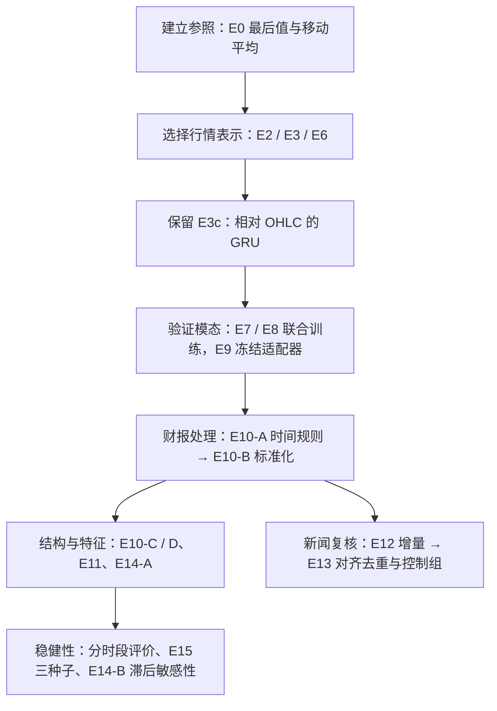

# 股票多模态预测：GRU 实验路径与阶段结果汇报

截至 2026 年 11 月 2 日｜建议用于 8～10 分钟阶段汇报

## 汇报页序建议

正文按研究问题组织，以下提纲可直接用于制作 8 页 PPT，总计约 9 分钟。第四节的完整结果表适合作为备份页，主讲时只展示与该页问题直接相关的结果。

| 页码／建议时长 | 页面标题 | 建议展示内容 | 这一页要讲清什么 |
| --- | --- | --- | --- |
| 1／45 秒 | 研究目标与阶段结论 | 96 日输入、24 日预测；E3c、E10-B、E10-D 的定位 | 已找到可继续研究的行情＋财报方案，但开发收益仍有限 |
| 2／1 分钟 | 数据与评价如何保证可比 | 三模态数据概况、开发／边界排除／本地测试切分 | 早停只用开发集，隔离预测标签重叠；本地测试不同于隐藏测试 |
| 3／1 分钟 | 为什么从基线走到相对价格 GRU | E0、E2、E3c 的 MAE；E3a/b/d 和 E6 用一句话概括 | E3c 改善了开发表现，但纯行情尚未稳定超过最后值 |
| 4／1 分钟 | 新闻与财报是否提供增量 | E7、E8、E9 的实验关系及 E3c/E9-2 对照 | 用冻结骨干隔离辅助模态的作用，财报值得进一步检查 |
| 5／1 分 30 秒 | 财报主线为何改进 | E10-B 结构图；E9-2 → E10-A → E10-B；E10-D 融合 | 财报时间处理与数值缩放得到改善，融合进一步降低开发 MAE |
| 6／1 分钟 | 哪些尝试没有稳定收益 | E10-C、E11、E12、E13、E14-A 的主要发现；新闻控制组 | 更多模态或特征未必更好，真实新闻内容尚未显示可靠增量 |
| 7／1 分 30 秒 | 改善是否稳定 | E15 三种子均值与标准差、30/60/90 天滞后、分时段结果 | E10-B 优于掩码方案的证据较一致，但跨时段收益不均匀 |
| 8／1 分钟 | 阶段判断与下一步 | 开发 MAE/MSE 改善 1.78%/2.94%；三项后续重点 | 保留财报主线，优先改进公告时间、财务口径和跨时期检验 |

## 一、阶段成果

本阶段围绕“行情是否足够预测未来价格，以及新闻、财报能否提供增量信息”开展实验，形成了从无训练基线、行情 GRU、模态融合到稳定性验证的完整对照路径。

**当前保留 E3c 作为行情骨干，E10-B 作为行情＋财报主线候选，E10-D 作为融合候选。** 主要进展来自行情输入相对化和财报特征标准化；新闻、扩展财报特征与字段缺失掩码尚未形成稳定改进。

相对最后值基线，E10-B 三种子平均开发 MAE 降低 **1.78%**、MSE 降低 **2.94%**；本地测试平均 MAE 降低 **5.59%**、MSE 降低 **6.81%**。开发集收益仍然有限，且不同时段表现有差异，现阶段不能据此承诺隐藏测试集得分。

> 汇报范围为 GRU 系列。E1 DLinear 是独立路线，未纳入此处最优方案的判断。本地测试指从官方验证集切出的 Holdout，并非官方隐藏测试集。

## 二、研究任务与评价设计

**预测任务：** 使用一只股票过去 96 个交易日的信息，直接预测未来 24 个交易日的收盘价。

| 项目 | 设置 |
| --- | --- |
| 数据规模 | 810 只股票，587,587 个训练样本，76,950 个官方验证样本 |
| 行情 | 日频 OHLC、成交量、分红、拆股；原始形状 `[96, 7]` |
| 新闻 | 每篇 512 维向量，每天篇数不固定 |
| 财报 | 利润表、资产负债表、现金流量表，低频结构化记录 |
| 输出 | 未来 24 天标准化 Close，批次形状 `[B, 24]` |
| 标签标准化 | 每只股票使用其训练期固定 Close 均值、标准差 |
| 训练目标 | 主要 GRU 实验使用 `MAE + 0.2 × MSE` |
| 模型选择 | 根据开发集 MAE 早停、保存最佳训练后检查点 |
| 评价指标 | 标准化价格上的 MAE、MSE，越小越好 |

为了将调参与模型评估分开，按时间进一步划分官方验证集：

```text
训练集：587,587 个样本 → 训练参数和拟合预处理统计量
官方验证集：
  较早段 42,930 个样本 → 开发验证、调参、早停
  边界段 18,630 个样本 → 排除，防止未来 24 日标签跨入测试期
  较晚段 15,390 个样本 → 本地测试，训练后评价
```

开发集的预测起始日为 2023-10-09～2023-12-20，本地测试的预测起始日为 2024-01-24～2024-02-27。开发标签最晚到 2024-01-23，早于测试首个预测日。

本地测试不参与训练循环中的早停，但研究中已多次查看，应作为辅助证据；最终泛化能力仍需在未参与研究决策的时间区间检验。

## 三、实验如何推进



| 阶段 | 要回答的问题 | 主要尝试 | 观察与后续决策 |
| --- | --- | --- | --- |
| 1. 建立参照 | 不学习能达到什么水平？ | E0：最后值、5/10/20 日均值 | 最后值优于移动平均，保留为核心参照 |
| 2. 确定行情骨干 | GRU 能否学到有效价格变化？ | E2 单变量；E3a/b/c/d 输入与目标；E6-A/B 七字段与平稳化 | E3c 相对 OHLC 的开发表现较均衡，选作后续骨干；纯行情测试仍未超过 E0 |
| 3. 检查模态增量 | 新闻和财报分别是否有帮助？ | E7 新闻、E8 财报联合训练；E9-1/2/3 冻结行情接入适配器 | 新闻开发表现退化；财报出现部分测试改善，继续检查处理方式 |
| 4. 改善财报利用 | 瓶颈是否来自时间与量纲？ | E10-A：30 天滞后及日历年龄；E10-B：训练集统计量标准化 | E10-B 相对 E10-A 的开发和测试指标均改善，成为财报主线 |
| 5. 结构与特征对照 | 更复杂或更简单是否更好？ | E10-C 快照 MLP；E10-D 固定融合；E11 比例与变化；E14-A 字段掩码 | 融合改善开发 MAE；其他变化未形成稳定优势 |
| 6. 再检查新闻 | 是新闻无效，还是处理方式不合适？ | E12 冻结财报基座加新闻；E13 修正时间归属、去重，比较真实／打乱／元信息 | 真实内容开发 MAE 未优于基座和控制组，暂缓扩大新闻模型 |
| 7. 检查稳定性 | 改善是否依赖随机性或某段行情？ | 固定模型分时段评价；E15 三种子；E14-B 30/60/90 天 | E10-B 优于掩码方案的证据更一致；保留 30 天近似，但跨时段收益仍不均匀 |

## 四、关键实验结果

除特别说明，以下为历史 seed 42 结果；E10-D 不重新训练，E13 使用线性残差模型。不同损失尺度下的训练 loss 不作直接比较，统一比较预测指标。

| 方案 | 主要变化 | 开发 MAE | 开发 MSE | 本地测试 MAE | 本地测试 MSE |
| --- | --- | ---: | ---: | ---: | ---: |
| E0 最后值复制 | 无训练参照 | 0.217307 | 0.131206 | 0.354286 | 0.330340 |
| [E2](../experiments/gru_e2/results.json) | 标准化 Close → GRU | 0.241438 | 0.167650 | 0.398728 | 0.438897 |
| [E3c](../experiments/gru_e3/result.json) | 相对 OHLC → GRU | 0.213222 | 0.128779 | 0.358988 | 0.336930 |
| [E7](../experiments/gru_e7/result.json) | 联合训练行情＋新闻 | 0.219304 | 0.132981 | 0.364273 | 0.340276 |
| [E9-2](../experiments/gru_e9_2/result.json) | 冻结行情＋财报适配器 | 0.216988 | 0.130395 | 0.349297 | 0.326557 |
| [E10-A](../experiments/gru_e10_a/result.json) | 财报滞后＋修正日历年龄 | 0.216775 | 0.130099 | 0.347855 | 0.325371 |
| [E10-B](../experiments/gru_e10_b/result.json) | 进一步标准化财报数值 | 0.213464 | 0.127426 | 0.337790 | 0.310866 |
| [E10-C](../experiments/gru_e10_c/result.json) | 财报 GRU 改成快照 MLP | 0.214011 | 0.127680 | 0.339175 | 0.311612 |
| [E11](../experiments/gru_e11/result.json) | 扩展比例与变化特征 | 0.216984 | 0.131445 | 0.344267 | 0.312536 |
| [E12](../experiments/gru_e12/result.json) | 冻结 E10-B 加新闻 | 0.227625 | 0.136840 | 0.340911 | 0.311792 |
| [E14-A](../experiments/gru_e14_a/result.json) | 增加字段缺失掩码 | 0.214254 | 0.127758 | 0.335860 | 0.309352 |
| [E10-D](../experiments/gru_e10_d/result.json) | E3c 与 E10-B 各占 50% | 0.211871 | 0.127187 | 0.346112 | 0.322019 |
| [E13 真实新闻](../experiments/gru_e13/result.json) | 对齐去重＋线性残差 | 0.215319 | 0.128087 | 0.333942 | 0.306331 |

三个值得强调的结果：

1. **输入表示是行情阶段的重要转折。** E2 开发 MAE 为 0.241438，E3c 降至 0.213222；相对 E0，E3c 开发 MAE 改善 1.88%，但本地测试 MAE 仍高 1.33%。这说明拟合能力增强并不自动转化为跨时期优势。
2. **财报标准化带来了进一步改善。** E10-A → E10-B，开发 MAE 从 0.216775 降至 0.213464，本地测试 MAE 从 0.347855 降至 0.337790。不过 E10-B seed 42 的开发 MAE 仍略高于 E3c，优势主要体现在开发 MSE 和本地测试。
3. **最优结论取决于评价范围。** 在上述方案中，E10-D 开发 MAE 最低；E13 真实新闻单次本地测试更好，但开发 MAE 比基座和新闻控制组更差。不能仅凭本地测试选 E13，也不能说 E10-B 的所有指标均最优。

完整 E3a/b/d、E6、E8、E9 等数值见 [详细实验对照](gru_experiments.md)。

## 五、当前财报主线的模型结构

E10-B 的核心思路是：保留已学好的行情预测，让财报只负责提供增量修正。

```text
相对 OHLC [B,96,4] → 冻结行情 GRU → 行情预测 [B,24]
                            │                  │
                            │                  ├───────────────┐
最新财报快照 [B,16] → 投影＋财报 GRU            │               │
                            │                  │               │
             行情隐藏状态＋财报表示 → 残差头 → 门控修正 ────────┘
                                               ↓
                                 最终预测 = 行情预测 + 财报修正
```

财报使用 12 个核心数值字段、3 个报告类型存在标记和 1 个报告年龄。数值先做 signed-log 压缩，再按训练集统计量标准化；行情分支固定，训练财报分支与修正头。

财报输入是同一份最新可用快照复制到 96 步，不是逐日更新的历史报告序列。E10-C 用单次 MLP 编码快照，当前单次表现略逊于 E10-B；这一结果尚不足以证明静态财报必须使用 GRU。

## 六、稳定性检查及负结果

### 6.1 多随机种子：缺失掩码未稳定超过原方案

预设 seed 42、43、44；两组共用同一个冻结行情骨干，只重训财报分支。下表为均值 ± 样本标准差，**不是模型集成后的分数**。

| 模型 | 开发 MAE | 开发 MSE | 本地测试 MAE | 本地测试 MSE |
| --- | --- | --- | --- | --- |
| E10-B | 0.213448 ± 0.000322 | 0.127347 ± 0.000080 | 0.334476 ± 0.002902 | 0.307854 ± 0.002673 |
| E14-A | 0.214305 ± 0.000310 | 0.128278 ± 0.000534 | 0.337677 ± 0.003981 | 0.311720 ± 0.004923 |

E14-A 在三组同种子比较中，开发 MAE/MSE 均未胜过 E10-B，本地测试仅 1/3 胜出。因此不因 seed 42 的一次测试改善替换主线。三种子只提供初步稳定性证据，不代表统计显著性，也没有覆盖行情骨干重新训练的随机性。

来源：[E15 汇总](../experiments/gru_e15/summary.md)。

### 6.2 财报滞后：当前保留 30 天

| 可用滞后 | 开发 MAE | 开发 MSE | 本地测试 MAE | 本地测试 MSE |
| --- | ---: | ---: | ---: | ---: |
| 30 天 | 0.213464 | 0.127426 | 0.337790 | 0.310866 |
| 60 天 | 0.214025 | 0.128889 | 0.348994 | 0.325355 |
| 90 天 | 0.216248 | 0.129508 | 0.349029 | 0.324620 |

在 seed 42 的相同协议下，开发集支持保留 30 天，延长滞后没有改善。没有同一标准化 E10-B 配置下的 0 天严格对照；旧 E9-2 还存在标准化和年龄计算差异，不能直接代替该消融。

来源：[E14-B 汇总](../experiments/gru_e14_b/summary.md)。

### 6.3 分时段：收益尚未跨时期一致

固定检查点在开发集三个连续时间段评价，E10-B 的 MAE 分别为 **0.221624、0.200507、0.218532**；对应 E3c 为 **0.222987、0.195288、0.221869**。财报方案在前后两段较好，中间段较差。

该检查没有逐段重训，检查点仍按整个开发集选择，且样本未来标签可能重叠，因此它是时间差异诊断，不能表述为三次独立滚动测试。

来源：[分时段结果](../experiments/gru_validation/rolling_validation_e10.json)。

### 6.4 新闻：未证实内容的稳定增量

E13 在修正非交易日新闻归属、同编号重复计权后，使用低容量线性修正，进一步比较：

| E13 开发集对照 | MAE | MSE |
| --- | ---: | ---: |
| E10-B 基座 | 0.213464 | 0.127426 |
| 仅数量／覆盖／新鲜度等元信息 | 0.215239 | 0.128091 |
| 元信息＋真实新闻内容 | 0.215319 | 0.128087 |
| 元信息＋打乱新闻内容 | 0.215270 | 0.128097 |

真实内容开发 MAE 未优于基座及两个控制组，尚不能证明其提供了可泛化的语义增量。本轮同时改变了预处理和残差模型，不能将结果完全归因于对齐或去重，也不能据此断言新闻本身没有价值。

来源：[E13 结果](../experiments/gru_e13/result.json)。

## 七、阶段判断与下一步

**已完成的工作：** 建立时间隔离的评价流程，比较行情输入、联合融合和冻结适配器，识别财报标准化的收益，并通过新闻控制组、多种子及滞后敏感性排除了一部分不稳定改进。

**当前判断：** 财报是当前 GRU 路线中更值得继续投入的模态；E10-B 保留为财报主线，E10-D 保留为开发集选出的融合候选。当前开发误差相对最后值仅改善约 2%，跨时期收益也不一致，仍有明显提升空间。

下一阶段按以下顺序推进：

1. **财报可用时间与口径。** 优先补公告／修订时间，核对累计值、单季度与同比口径，再构造少量可解释特征。报告期末加 30 天只是近似，尚不能保证消除未来信息。
2. **加强跨时期检验。** 在数据条件允许时增加按时间推进、每折重训的验证，避免将固定模型分段评价当成独立泛化证据。
3. **设置公平的骨干对照。** 固定输入、财报规则和训练协议，再比较替代行情骨干或轻量财报编码，不同时更换多个因素。
4. **新闻按证据恢复。** 当前暂停扩大新闻网络；只有在开发集优于基座、元信息及打乱控制，且跨种子／时段一致后，再投入复杂融合。

### 可直接用于汇报结尾的表述

> 本阶段先用最后值复制建立强基线，再通过相对价格输入确定 GRU 行情骨干，随后分别检验新闻与财报的增量价值。主要进展来自财报特征标准化：E10-B 三种子平均开发 MAE 和 MSE 相对基线降低约 1.78% 和 2.94%，本地测试降低约 5.59% 和 6.81%。新闻及更复杂特征尚未体现稳定优势。下一步重点是财报可用时间、特征口径和跨时期验证，而不是直接扩大模型规模。

## 结果依据

数据与形状：[项目介绍](intro.md)；全部 GRU 对照与原始结果链接：[实验记录](gru_experiments.md)；代码入口与切分规则：[实验目录索引](../experiments/README.md)。最终提交文件为根目录的 `model.py` 与 `model.pt`；当前选择 E10-B 行情＋财报方案，不使用新闻分支。
